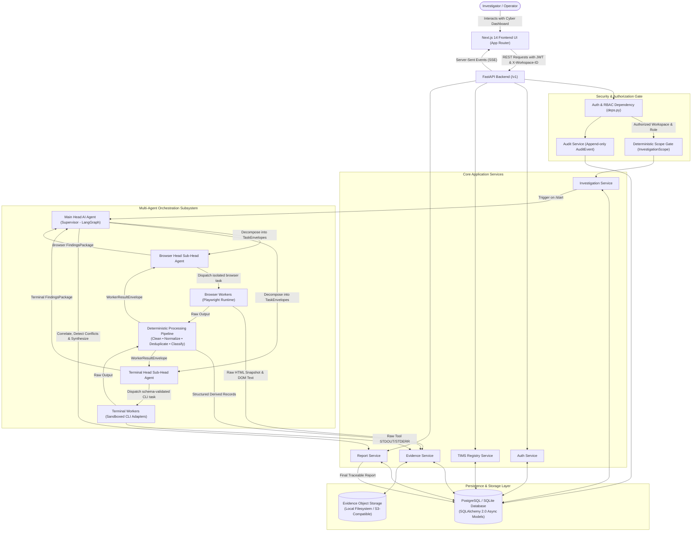
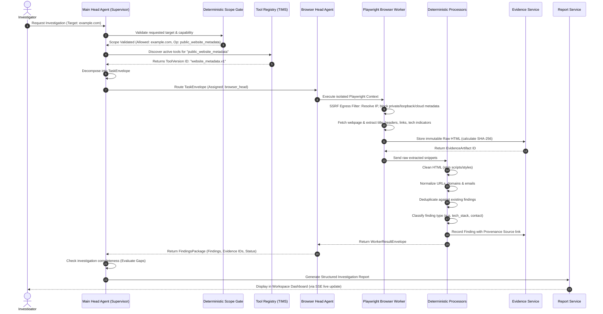
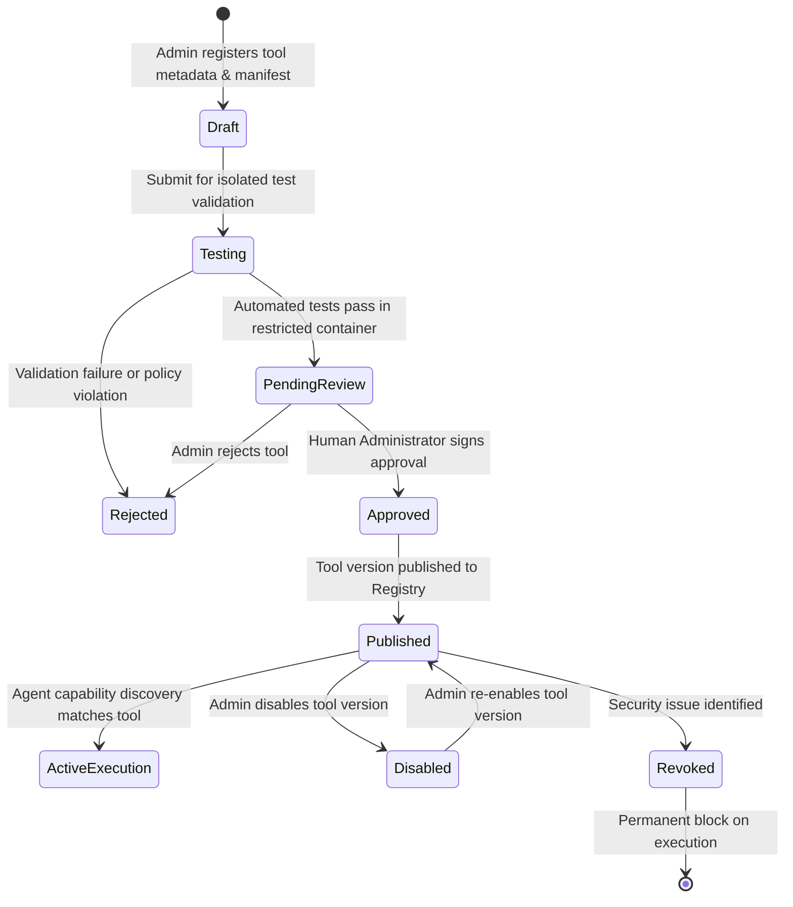
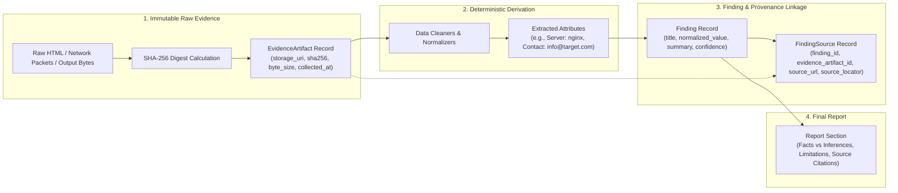
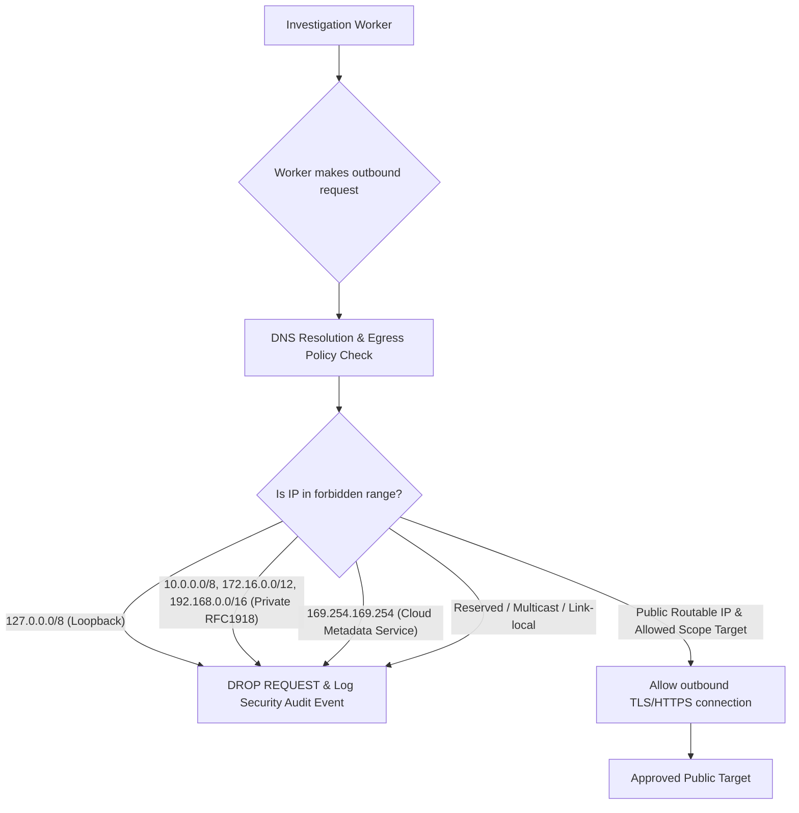

# ZAPRICA System Architecture & End-to-End Workflow Map

This document explains in detail how all components, data structures, agents, databases, and security boundaries in ZAPRICA connect to each other.

---

## 1. Global System Flowchart

The following diagram maps the entire architecture from the user's browser down to low-level workers and back to the report dashboard:

---

## 2. The 3-Tier Agent Hierarchy & Communication Flow

ZAPRICA rejects flat, unrestricted chatbot architecture in favor of a strictly structured **3-Tier Agent Hierarchy**. Agent communication never uses loose natural language prompts as the sole contract; all communication is typed, versioned, and validated with Pydantic envelopes.

---

## 3. Tool Intelligence & Management System (TIMS) Lifecycle

New tools are added without changing core application or agent source code. A tool must pass through strict lifecycle states before being executable.

---

## 4. Evidence Provenance & Immutability Chain

Every insight shown to an investigator retains an unbroken chain of custody linked to raw artifacts:

---

## 5. Security Egress & Sandboxing Architecture

To prevent Server-Side Request Forgery (SSRF) and host escape:

---

## 6. Directory Structure Mapping

- `backend/app/core/`: Application settings, async database configuration, security (JWT/Bcrypt), event bus (SSE).
- `backend/app/models/`: SQLAlchemy 2.0 async database models (19 tables spanning users, workspaces, investigations, tasks, tools, evidence, entities, reports, audit).
- `backend/app/schemas/`: Pydantic 2.x request/response models conforming to `docs/API_SPEC.yaml`.
- `backend/app/services/`: Pure business logic (`AuthService`, `InvestigationService`, `EvidenceService`, `ToolService`, `ReportService`).
- `backend/app/storage/`: Pluggable evidence storage backends (`LocalStorageBackend`, `S3StorageBackend`).
- `backend/app/agents/`:
  - `contracts.py`: Typed envelopes for task dispatch, worker results, and findings packages.
  - `main_head/`: LangGraph orchestration supervisor.
  - `browser_head/`: Playwright supervisor and SSRF egress filter.
  - `terminal_head/`: Sandboxed CLI tool execution supervisor.
  - `workers/`: Web scrapers, CLI adapters, and deterministic data processors (`DataCleaner`, `DataNormalizer`, `DuplicateDetector`, `DataClassifier`).
- `frontend/src/app/`: Next.js 14 App Router pages (Dashboard, Investigations Workspace, Evidence Explorer, Agent Center, Tool Manager, Reports, Settings).
- `frontend/src/components/`: Reusable UI components (Sidebar, Navbar, Task Graph, Evidence Viewer).
- `docs/`: Technical specifications, architecture invariants, and database contracts.
- `WORK_LOG.md`: Master continuous execution tracker.
