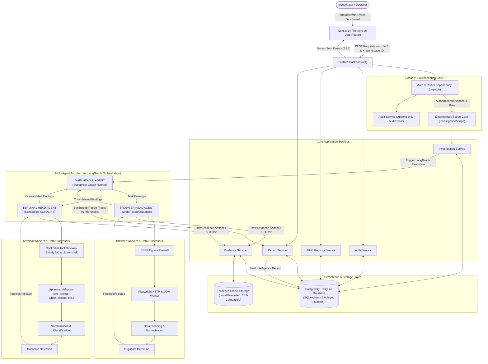
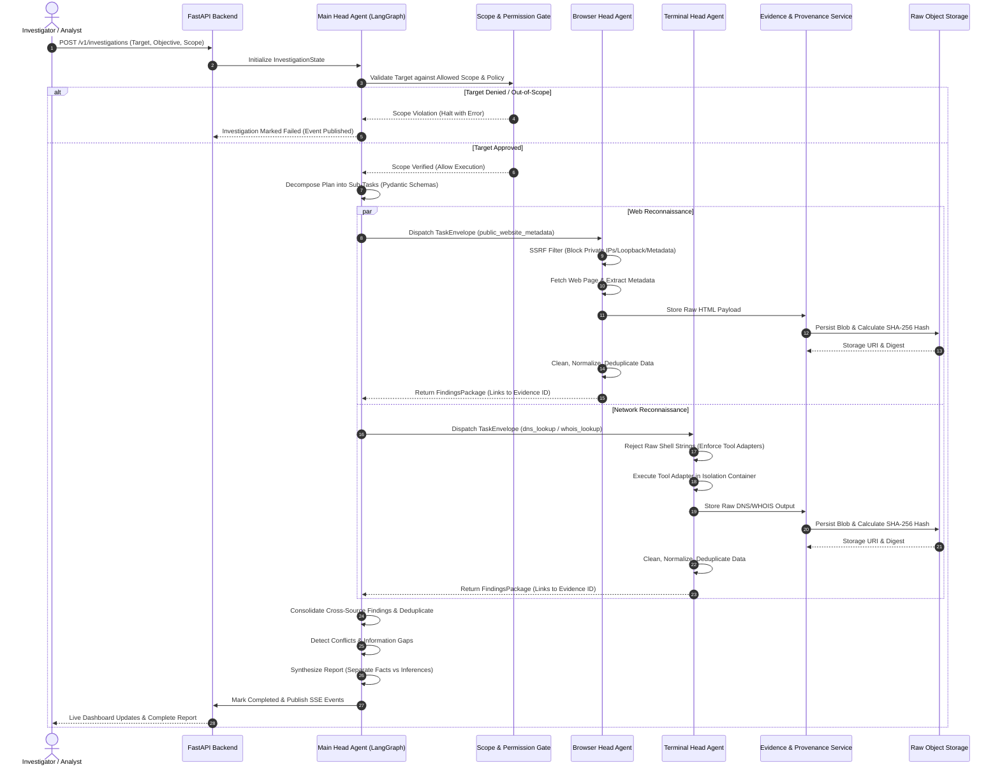
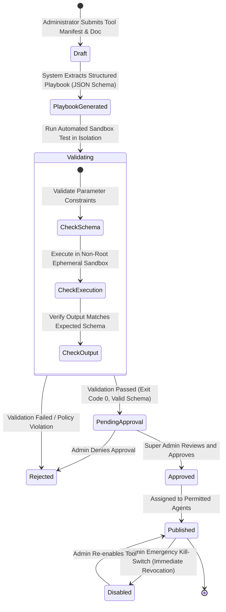
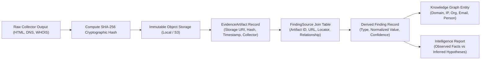
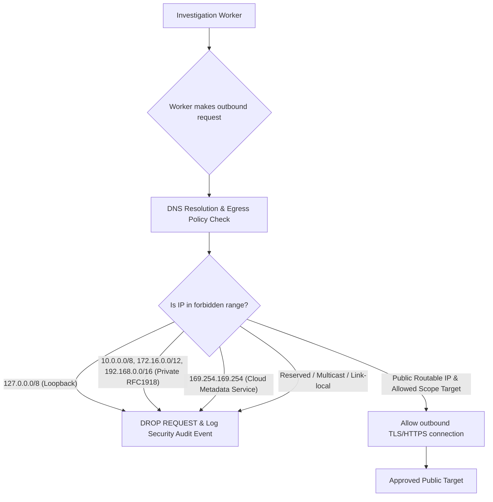
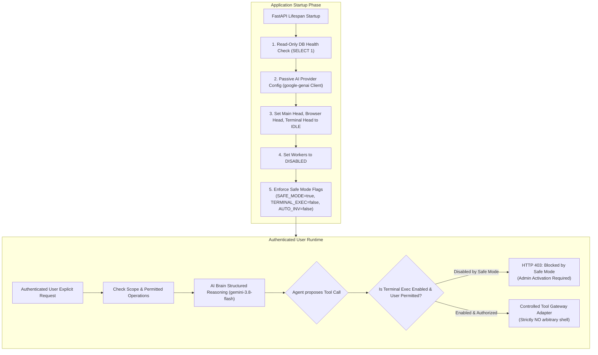
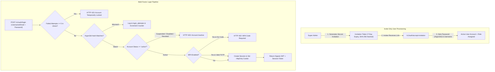
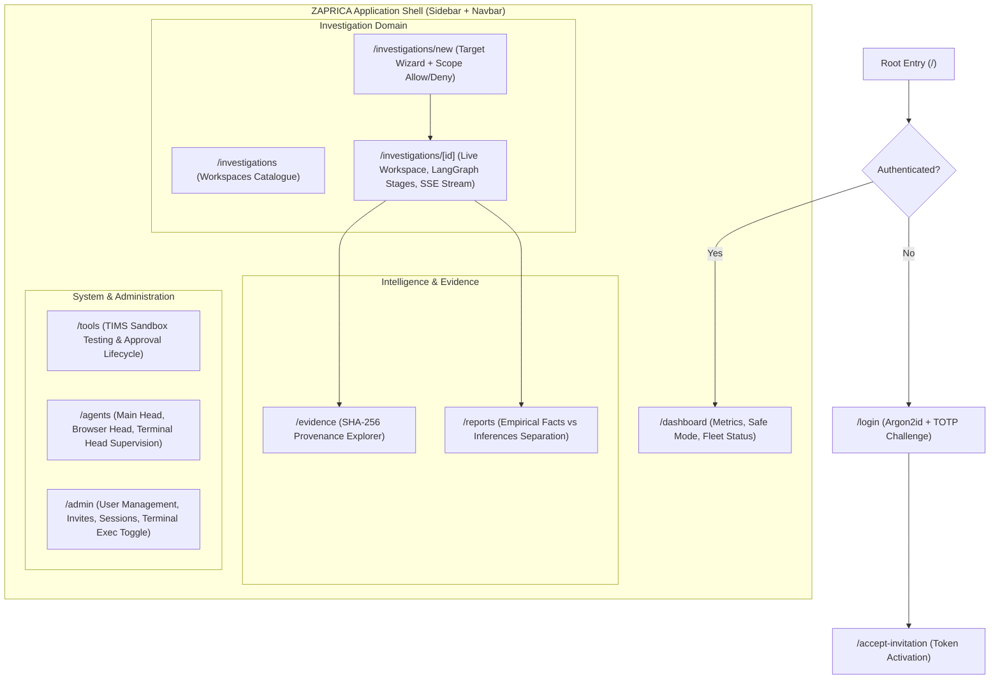
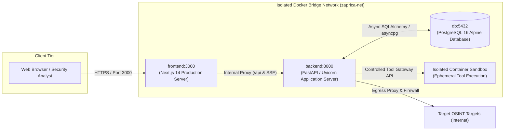

# ZAPRICA System Architecture & End-to-End Workflow Map

This document explains in detail how all components, data structures, agents, databases, and security boundaries in ZAPRICA connect to each other.

---

## 1. Global System Flowchart

The following diagram maps the entire architecture from the user's browser down to low-level workers and back to the report dashboard:

---

## 2. 3-Tier Agent Hierarchy & Decision Cycle

---

## 3. Tool Intelligence & Management System (TIMS) Lifecycle

---

## 4. Evidence Integrity & Provenance Chain

---

## 5. Security Egress & Sandboxing Architecture

To prevent Server-Side Request Forgery (SSRF) and host escape:

---

## 6. Google Gemini AI Brain & Safe Startup Mode

---

## 7. Invite-Only Authentication & Session Verification

---

## 8. Frontend UI & Component Route Map

---

## 9. Deployment Architecture & Docker Multi-Service Topology

