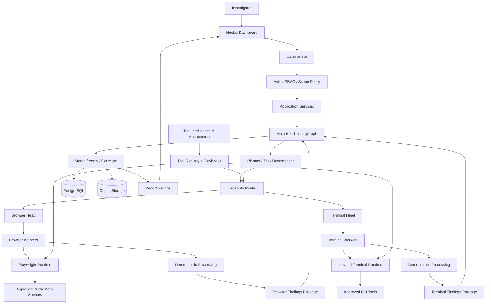
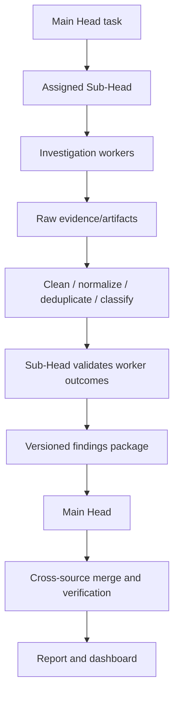

# ZAPRICA System Architecture

- Status: Proposed architecture
- Version: 0.1
- Last updated: 2026-10-31

## 1. Architecture principles

1. Main Head is the global supervisor and final synthesizer.
2. Browser Head and Terminal Head are independent domain supervisors, not peer global planners.
3. Workers do bounded work and report to their own Sub-Head.
4. The Main Head receives reviewed findings packages from both Sub-Heads.
5. Authorization is enforced by deterministic services outside the LLM.
6. Raw evidence is immutable; processing creates linked derived findings.
7. Tooling is registry-driven, capability-scoped, versioned, tested, and approved.
8. Start with a modular monolith plus isolated execution workers. Split services only when scaling or security boundaries justify it.

## 2. Recommended stack

| Layer | Choice | Why |
|---|---|---|
| Web | Next.js App Router, React, TypeScript | Mature full-stack React framework and file-based routing. |
| UI | Tailwind CSS and accessible component primitives | Consistent dashboard components. |
| API | FastAPI, Pydantic | Typed Python API and validation at boundaries. |
| Agent graph | LangGraph | Explicit nodes/edges, state, checkpointing, subgraphs, and human approval interrupts. |
| Workflow durability | Temporal later | Durable long-running execution, retries, timers, and recovery; defer until useful. |
| Database | PostgreSQL | Transactional system of record and relational queries. |
| ORM/migrations | SQLAlchemy 2.x, Alembic | Explicit mappings and controlled schema evolution. |
| Object store | S3-compatible object storage | Screenshots, source snapshots, downloaded artifacts, exports. |
| Browser | Playwright | Browser contexts and controlled browser automation. |
| Terminal | Rootless container runtime with seccomp | Isolated, resource-limited command execution. |
| Tool interface | Internal registry/adapter contract; MCP connectors where useful | ZAPRICA retains policy control while supporting standard tool interoperability. |
| Cache | Redis optional | Add for cache/ephemeral coordination only when measured need appears. |

Do not pin versions in prose. Select current supported versions during implementation, commit lockfiles, and run compatibility/security checks. For API contracts this repository uses OpenAPI 3.1.1 as a compatibility baseline; evaluate OpenAPI 3.2.x after the chosen FastAPI, validators, code generators, and documentation tools are verified together.

## 3. Logical architecture



## 4. Runtime responsibilities

### 4.1 Frontend

Pages: login, dashboard, new investigation, investigation workspace, agent/task activity, evidence explorer, relationship view (later), reports, tool manager (admin), settings.

The frontend is not an authority boundary. All permissions and scope checks occur in the backend. Progress can be delivered via Server-Sent Events (SSE) for the first release.

### 4.2 Backend application

Use FastAPI as a modular application with routers, application services, domain models, repositories, and infrastructure adapters. Routes authenticate and validate requests, then call application services. They must not execute tools or contain agent prompts directly.

Suggested modules: `auth`, `workspaces`, `investigations`, `scopes`, `tasks`, `agents`, `tools`, `evidence`, `findings`, `reports`, `audit`, `approvals`, `events`.

### 4.3 Main Head Agent

Main Head graph nodes:

1. `parse_request`: convert user request into a typed intent; ask for clarification when essential details are missing.
2. `scope_gate`: ask policy service whether the intended actions/targets are allowed.
3. `plan`: produce a plan with objectives, rationale, dependencies, and expected outputs.
4. `decompose`: create typed tasks with capabilities, allowed tools, input schemas, budgets, deadlines, and risk class.
5. `route`: send browser tasks to Browser Head and approved command-line tasks to Terminal Head.
6. `monitor`: receive status events and handle timeouts/failures.
7. `consolidate`: validate findings packages, merge records, identify cross-source duplicates/conflicts.
8. `evaluate_gaps`: decide whether the authorized objective is sufficiently answered.
9. `replan`: create bounded follow-up tasks or pause for approval; never silently expand scope.
10. `report`: produce evidence-linked summaries, limitations, and exports.

Use a persistent LangGraph checkpointer in deployed environments. Keep investigation records and evidence in the application database/object store; do not treat an LLM context window as the system of record.

### 4.4 Browser Head Agent & Dedicated Browser Environment

Owns browser-specific task decomposition, worker scheduling, browser context lifecycle, rate limits, target allowlists, and result review.
- Operates a dedicated Playwright Chromium browser environment (not HTTPX).
- **Profile Isolation**: Profiles are isolated per user in `data/browser_profiles/<user_id>/` outside version control, with path traversal prevention.
- **Human-in-the-Loop Login Protocol**: Sessions requiring manual authentication or 2FA transition through `LOGIN_REQUIRED` -> `AUTHENTICATING` -> `USER_AUTHENTICATED`. Investigators take manual control and explicitly click "CONFIRM USER AUTHENTICATED" before automation resumes.
- **Website Automation Policies**: Evaluates target domains against `AUTOMATED_ALLOWED`, `HUMAN_ASSISTED_ONLY`, `API_ONLY`, and `BLOCKED`.
- **Epieos Special Handling**: Strictly configured as `HUMAN_ASSISTED_ONLY` with manual user access and manual result import. Automated scraping and queries are prohibited by policy.
- **SSRF & Egress Security**: Validates DNS, blocks RFC 1918, loopbacks, and cloud metadata (`169.254.169.254`) on all navigation hops and redirects.

### 4.5 Terminal Head Agent & Dedicated Sandbox Environment

Owns approved CLI task decomposition and isolated runtime lifecycle.
- **Docker Container Sandbox**: Executes commands exclusively inside non-root Alpine container sandboxes (`--read-only` rootfs, `--tmpfs /workspace:rw,noexec,nosuid,size=64m`, `--user 10001:10001`, `--cap-drop=ALL`, `--security-opt=no-new-privileges`, `--pids-limit=64`).
- **Strict Fail-Closed Guarantee**: Under NO circumstances does the agent execute commands on the Windows host. If Docker is offline or disabled, execution is rejected with HTTP 503.
- **Command Allowlist & Injection Defense**: Commands must match allowlisted specifications (`dns_lookup`, `whois_lookup`, `metadata_extractor`, `subdomain_enum`, `cert_inspector`). Shell chaining, pipes, and metacharacters are strictly rejected.
- **Terminal Workers**: CLI OSINT Worker, Network Intelligence Worker, Metadata Analysis Worker, File & Document Worker.
- **Observability**: Raw execution logs capture stdout, stderr, exit code, and duration in `terminal_execution_logs`.

### 4.6 Workers and deterministic processors

Example browser workers: web page metadata collector, authorized profile/public-page collector, content extractor. Example terminal workers: approved CLI adapter worker, metadata parser, file parser. Worker examples are capability categories, not permission to deploy every tool.

Processing functions: canonicalization, schema validation, normalization, duplicate detection, classification, sorting, redaction, and provenance linking. Use deterministic Python functions unless a documented reason requires a model.

## 5. Agent and task communication contract

Never use free-form messages as the sole execution contract. All messages must be typed, versioned, and correlated.

### Task envelope

```json
{
  "schema_version": "1.0",
  "task_id": "uuid",
  "investigation_id": "uuid",
  "parent_task_id": null,
  "requesting_agent": "main_head",
  "assigned_agent": "browser_head",
  "capability": "public_website_metadata",
  "objective": "Collect approved public metadata for the scoped domain",
  "scope_ref": "uuid",
  "allowed_tool_ids": ["website_metadata"],
  "input": {"target": "example.org"},
  "expected_output_schema": "website_metadata_result.v1",
  "risk_class": "low",
  "approval_ref": null,
  "budget": {"max_tool_calls": 5, "max_runtime_seconds": 60},
  "deadline": "ISO-8601 UTC timestamp",
  "idempotency_key": "stable-key"
}
```

### Worker result envelope

```json
{
  "schema_version": "1.0",
  "task_id": "uuid",
  "agent_id": "browser_worker",
  "status": "success",
  "outcome": "findings_returned",
  "findings": [],
  "evidence_refs": [],
  "tool_run_refs": [],
  "warnings": [],
  "error": null,
  "started_at": "ISO-8601 UTC timestamp",
  "completed_at": "ISO-8601 UTC timestamp"
}
```

Allowed statuses should include `queued`, `running`, `awaiting_approval`, `succeeded`, `no_findings`, `partial`, `failed`, `timed_out`, `cancelled`. A no-findings response is not a failure.

### Findings package return flow



Every worker returns status even if it found nothing. Sub-Heads validate that findings have source/evidence references and report partial failures.

## 6. Tool Intelligence & Management System (TIMS)

TIMS allows future tools to be introduced without changing core agent code.

### 6.1 Onboarding flow

1. Administrator creates a draft tool record.
2. Administrator provides tool name, purpose, vendor/project source, version, license, package/source reference, documentation, dependencies, execution type, capabilities, and expected input/output.
3. Documentation analyzer extracts a **draft** playbook: what the tool does, appropriate tasks, constraints, parameters, output interpretation, errors, and examples.
4. Developer creates/reviews a narrow adapter implementing ZAPRICA's Tool Adapter interface.
5. Build pipeline pins dependencies, records artifact digest/provenance, checks license and known vulnerabilities, and validates the manifest.
6. Tool is tested in an isolated, egress-restricted environment using synthetic/non-sensitive fixtures.
7. Automated tests and security checks run; a human administrator reviews and approves the exact version and permission profile.
8. Approved version is published to the registry and assigned to eligible agent classes.
9. Agents discover tools by capability and retrieve the applicable playbook at task time.
10. Updates create a new version and repeat validation; rollback can reactivate a previously approved version.

### 6.2 Tool manifest fields

Required fields: `tool_id`, `display_name`, `version`, `description`, `vendor_or_source`, `license`, `artifact_digest`, `execution_type`, `capabilities`, `allowed_agent_types`, `input_schema`, `output_schema`, `permissions`, `network_policy`, `resource_limits`, `timeout_seconds`, `playbook_ref`, `test_suite_ref`, `approval_status`, `approved_by`, `approved_at`.

### 6.3 Tool states

`draft` → `testing` → `pending_review` → `approved` → `published` → `disabled` or `revoked`.

A rejected version moves to `rejected`; it cannot execute. Disabled/revoked tools must be unavailable to dispatch immediately. A tool version is immutable once approved; edits create a new version.

### 6.4 Runtime tool discovery

- Main Head asks the registry for capabilities needed by a task.
- Registry returns only active versions compatible with the assigned agent and scope.
- Agent retrieves the relevant playbook and schema, not every tool's documentation.
- Policy service checks target, permission, budget, approval, and rate limits.
- Tool Gateway validates arguments and executes the registered adapter in the correct runtime.
- Output is size-limited, schema-validated, sanitized, and recorded with tool version and provenance.

Tool documentation and external tool output are reference data, never privileged instructions.

## 7. Evidence and data flow

- Original HTML snapshots, files, screenshots, and command outputs are stored as immutable artifacts in object storage with SHA-256 digest, media type, size, collector, timestamp, and retention class.
- Structured normalized records live in PostgreSQL.
- Each finding references one or more evidence artifacts and source locators.
- Transformations create derived records and record processor name/version and input references.
- Reports reference finding IDs and evidence IDs; they do not copy unverified model claims as facts.

## 8. Task lifecycle and reliability

Task lifecycle: `queued` → `running` → (`awaiting_approval` | `succeeded` | `no_findings` | `partial` | `failed` | `timed_out` | `cancelled`).

- Apply deadlines, tool-call budgets, token budgets, output size limits, and bounded retries.
- Retry only transient failures; do not retry authorization denials or invalid input.
- Use idempotency keys for task creation and adapter execution when possible.
- Persist state before/after external side effects.
- Use an outbox/event table or another reliable event publication pattern if DB updates and events must be atomic.
- A task can be resumed only if scope and tool version remain valid.
- Temporal can be introduced after the MVP if long-running workflows, durable timers, cross-process retries, or operational recovery justify another runtime.

## 9. Deployment shape

Initial shape: Next.js web app, FastAPI app, PostgreSQL, object storage, optional Redis, LangGraph runtime integrated with backend worker processes, isolated Playwright service, isolated terminal sandbox service. Keep the tool gateway and execution runtime behind private network boundaries. Production should use a separate worker identity and network policy per execution type.

## 10. References

Review official documentation and pin versions during implementation:

- Next.js App Router: https://nextjs.org/docs/app
- FastAPI: https://fastapi.tiangolo.com/
- LangGraph persistence: https://langchain-ai.github.io/langgraph/concepts/persistence/
- LangGraph interrupts / human approval: https://langchain-ai.github.io/langgraph/concepts/breakpoints/
- Temporal: https://docs.temporal.io/
- Playwright browser contexts: https://playwright.dev/docs/browser-contexts
- Docker rootless mode: https://docs.docker.com/engine/security/rootless/
- Docker seccomp: https://docs.docker.com/engine/security/seccomp/
- MCP specifications: https://modelcontextprotocol.io/specification/
- OpenAPI 3.2.1 (current specification reference): https://spec.openapis.org/oas/v3.2.1.html
- OWASP GenAI Security Project: https://owasp.org/www-project-top-10-for-large-language-model-applications/
