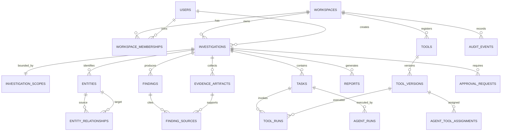

# ZAPRICA Database Schema

- Status: Proposed logical schema
- Version: 0.1
- Last updated: 2026-10-31
- Database: PostgreSQL

## 1. Conventions

- Primary keys: UUID.
- Timestamps: `timestamptz`, stored in UTC.
- Flexible vendor/tool/result metadata: JSONB with schema validation at application boundaries.
- Money/secrets: do not store provider secrets in this database. Use a secret manager and store only secret references.
- All workspace-owned tables include `workspace_id` directly or through a parent relation and must be workspace-scoped in every query.
- Raw evidence objects are stored in object storage; PostgreSQL stores metadata, hashes, and relationships.
- Use soft deletion only where there is an operational/legal reason; retention and deletion policy must be explicit.

## 2. Core relationship diagram

## 3. Tables

### 3.1 Identity and workspace

#### `users`

| Column | Type | Constraints / notes |
|---|---|---|
| id | uuid | PK |
| email | citext | unique; normalized |
| display_name | text | required |
| password_hash | text | nullable if external OIDC only; never plaintext |
| status | text | `active`, `invited`, `disabled` |
| mfa_enrolled_at | timestamptz | nullable |
| created_at, updated_at | timestamptz | required |

#### `workspaces`

`id uuid PK`, `name text`, `slug citext UNIQUE`, `status text`, `created_at`, `updated_at`.

#### `workspace_memberships`

`id uuid PK`, `workspace_id uuid FK`, `user_id uuid FK`, `role text`, `status text`, `created_at`. Unique `(workspace_id, user_id)`. Roles: `admin`, `investigator`, `reviewer`, `viewer`.

### 3.2 Investigation and scope

#### `investigations`

| Column | Type | Constraints / notes |
|---|---|---|
| id | uuid | PK |
| workspace_id | uuid | FK workspaces, required |
| created_by | uuid | FK users |
| title | text | required, length-limited |
| objective | text | required; minimize personal data |
| investigation_type | text | controlled category |
| status | text | lifecycle enum from PRD |
| priority | text | bounded enum |
| plan_json | jsonb | validated plan snapshot |
| model_policy_id | text | nullable policy reference, not secret |
| started_at, completed_at | timestamptz | nullable |
| retention_until | timestamptz | required by retention policy |
| created_at, updated_at | timestamptz | required |

Indexes: `(workspace_id, created_at DESC)`, `(workspace_id, status, created_at DESC)`, GIN on `plan_json` only if query patterns justify it.

#### `investigation_scopes`

`id uuid PK`, `investigation_id uuid FK UNIQUE`, `workspace_id uuid FK`, `purpose text`, `allowed_targets jsonb`, `allowed_operations jsonb`, `denied_targets jsonb`, `expires_at timestamptz`, `approved_by uuid FK users nullable`, `approved_at timestamptz nullable`, `policy_version text`, `created_at`.

Store normalized target records if target querying becomes frequent; do not rely on opaque JSON for authorization checks. The policy service must canonicalize and evaluate each target/redirect/address before execution.

### 3.3 Tasks and agent runs

#### `tasks`

`id uuid PK`, `workspace_id uuid FK`, `investigation_id uuid FK`, `parent_task_id uuid FK tasks nullable`, `requesting_agent text`, `assigned_agent text`, `capability text`, `objective text`, `status text`, `risk_class text`, `input_json jsonb`, `expected_output_schema text`, `allowed_tool_ids jsonb`, `idempotency_key text`, `budget_json jsonb`, `deadline_at timestamptz`, `attempt_count integer`, `created_at`, `started_at`, `completed_at`, `error_code text nullable`, `error_summary text nullable`.

Unique `(workspace_id, idempotency_key)` where idempotency key is not null. Index `(investigation_id, status)`, `(assigned_agent, status)`, `(parent_task_id)`.

#### `agent_runs`

`id uuid PK`, `workspace_id uuid FK`, `investigation_id uuid FK`, `task_id uuid FK`, `agent_id text`, `agent_type text`, `model_provider text nullable`, `model_name text nullable`, `prompt_version text nullable`, `status text`, `started_at`, `completed_at`, `input_tokens integer nullable`, `output_tokens integer nullable`, `cost_microunits bigint nullable`, `trace_id text`, `error_json jsonb nullable`.

Do not store full chain-of-thought. Store operational events, tool calls, concise rationale/decision metadata, model/provider identifiers, and references needed for audit.

### 3.4 Tool intelligence and management (TIMS)

#### `tools`

`id uuid PK`, `workspace_id uuid FK`, `tool_key text`, `display_name text`, `description text`, `vendor_or_source text`, `homepage_url text nullable`, `license_id text`, `status text`, `created_by uuid FK users`, `created_at`, `updated_at`. Unique `(workspace_id, tool_key)`.

#### `tool_versions`

`id uuid PK`, `tool_id uuid FK`, `version text`, `execution_type text` (`browser`, `terminal`, `api`, `library`), `capabilities jsonb`, `input_schema jsonb`, `output_schema jsonb`, `manifest_json jsonb`, `playbook_markdown text`, `artifact_uri text nullable`, `artifact_sha256 text nullable`, `dependency_lock_uri text nullable`, `test_result_json jsonb nullable`, `permission_profile jsonb`, `network_policy jsonb`, `resource_limits jsonb`, `timeout_seconds integer`, `approval_status text`, `approved_by uuid FK users nullable`, `approved_at timestamptz nullable`, `published_at timestamptz nullable`, `created_at`.

Unique `(tool_id, version)`. Once approved/published, version rows are immutable; create a new row for changes. Index `(approval_status, execution_type)` and GIN on `capabilities` if capability lookup warrants it.

#### `agent_tool_assignments`

`id uuid PK`, `workspace_id uuid FK`, `tool_version_id uuid FK`, `agent_type text`, `capability text`, `enabled boolean`, `scope_constraints jsonb`, `assigned_by uuid FK users`, `created_at`, `updated_at`. Unique `(tool_version_id, agent_type, capability)`.

#### `tool_runs`

`id uuid PK`, `workspace_id uuid FK`, `investigation_id uuid FK`, `task_id uuid FK`, `tool_version_id uuid FK`, `agent_run_id uuid FK nullable`, `requested_by_agent text`, `status text`, `input_digest text`, `validated_input_json jsonb`, `output_artifact_id uuid nullable`, `started_at`, `completed_at`, `duration_ms integer`, `exit_code integer nullable`, `error_code text nullable`, `policy_decision_id text`, `trace_id text`.

Avoid logging secrets or full sensitive payloads. Store large output in evidence artifacts with a reference.

### 3.5 Evidence and findings

#### `evidence_artifacts`

`id uuid PK`, `workspace_id uuid FK`, `investigation_id uuid FK`, `task_id uuid FK nullable`, `tool_run_id uuid FK nullable`, `storage_uri text`, `media_type text`, `byte_size bigint`, `sha256 text`, `source_locator text nullable`, `source_url text nullable`, `collected_by text`, `collected_at timestamptz`, `captured_at timestamptz nullable`, `integrity_status text`, `retention_until timestamptz`, `metadata_json jsonb`, `created_at`.

Indexes: `(investigation_id, collected_at DESC)`, `(workspace_id, sha256)`, `(task_id)`.

#### `findings`

`id uuid PK`, `workspace_id uuid FK`, `investigation_id uuid FK`, `task_id uuid FK nullable`, `finding_type text`, `title text`, `normalized_value text nullable`, `summary text`, `verification_status text`, `confidence_level text`, `confidence_reason text nullable`, `relevance_score numeric nullable`, `first_observed_at timestamptz`, `last_observed_at timestamptz`, `processor_name text nullable`, `processor_version text nullable`, `derived_from jsonb`, `created_at`, `updated_at`.

Indexes: `(investigation_id, finding_type)`, `(investigation_id, verification_status)`, `(investigation_id, relevance_score DESC)`, GIN full-text index on generated/search vector where appropriate. Avoid indexing sensitive raw text without a reviewed need.

#### `finding_sources`

`id uuid PK`, `finding_id uuid FK`, `evidence_artifact_id uuid FK`, `source_url text nullable`, `source_locator text nullable`, `source_title text nullable`, `observed_at timestamptz`, `relationship text`, `notes text nullable`. Unique `(finding_id, evidence_artifact_id, source_locator)`.

#### `entities`

`id uuid PK`, `workspace_id uuid FK`, `investigation_id uuid FK`, `entity_type text`, `display_label text`, `normalized_key text nullable`, `attributes_json jsonb`, `verification_status text`, `created_at`, `updated_at`.

#### `entity_relationships`

`id uuid PK`, `workspace_id uuid FK`, `investigation_id uuid FK`, `source_entity_id uuid FK entities`, `target_entity_id uuid FK entities`, `relationship_type text`, `direction text`, `evidence_finding_id uuid FK findings nullable`, `confidence_level text`, `created_at`.

Do not infer identity or relationships from name similarity alone. Relationships must be evidence-backed and visibly labeled as observed, inferred, or unverified.

### 3.6 Reports, approvals, and audit

#### `reports`

`id uuid PK`, `workspace_id uuid FK`, `investigation_id uuid FK`, `version integer`, `status text`, `title text`, `summary text`, `report_json jsonb`, `artifact_id uuid FK evidence_artifacts nullable`, `created_by_agent text`, `reviewed_by uuid FK users nullable`, `created_at`, `finalized_at timestamptz nullable`. Unique `(investigation_id, version)`.

#### `approval_requests`

`id uuid PK`, `workspace_id uuid FK`, `investigation_id uuid FK`, `task_id uuid FK nullable`, `requested_by_agent text`, `action_type text`, `request_json jsonb`, `risk_class text`, `status text`, `decided_by uuid FK users nullable`, `decision_reason text nullable`, `created_at`, `decided_at timestamptz nullable`, `expires_at timestamptz`.

#### `audit_events`

`id uuid PK`, `workspace_id uuid FK`, `actor_type text`, `actor_id text`, `action text`, `resource_type text`, `resource_id uuid nullable`, `investigation_id uuid FK nullable`, `decision text`, `reason_code text nullable`, `ip_hash text nullable`, `trace_id text`, `metadata_redacted jsonb`, `created_at`.

Append-only to application roles. Send required security logs to a protected log sink. Retention must follow the applicable legal and operational requirements.

### 3.8 Dedicated Browser & Terminal Environments

#### `browser_profiles`
`id uuid PK`, `user_id uuid FK users`, `profile_name text`, `profile_path text`, `is_active boolean`, `created_at`, `updated_at`. Isolated per user outside git.

#### `browser_sessions`
`id uuid PK`, `investigation_id uuid FK investigations`, `user_id uuid FK users`, `profile_name text`, `status text` (`DISCONNECTED`, `STARTING`, `LOGIN_REQUIRED`, `AUTHENTICATING`, `USER_AUTHENTICATED`, `READY`, `BUSY`, `SESSION_EXPIRED`, `STOPPED`, `ERROR`), `current_url text`, `auth_state jsonb`, `started_at`, `last_activity_at`, `ended_at`.

#### `browser_session_events`
`id uuid PK`, `session_id uuid FK browser_sessions`, `event_type text`, `target_url text`, `details jsonb`, `created_at`.

#### `browser_tasks`
`id uuid PK`, `session_id uuid FK browser_sessions`, `task_envelope_id uuid nullable`, `action text`, `target_url text`, `status text`, `error_message text`, `result_metadata jsonb`, `created_at`, `completed_at`.

#### `terminal_environments`
`id uuid PK`, `workspace_id uuid FK workspaces`, `environment_type text` (`DOCKER_CONTAINER`), `container_id text`, `status text` (`READY`, `BUSY`, `OFFLINE`, `TERMINATED`), `created_at`, `updated_at`.

#### `terminal_sessions`
`id uuid PK`, `investigation_id uuid FK investigations`, `user_id uuid FK users`, `environment_id uuid FK terminal_environments`, `status text`, `started_at`, `last_activity_at`, `ended_at`.

#### `terminal_tasks`
`id uuid PK`, `session_id uuid FK terminal_sessions`, `tool_id text`, `command_spec text`, `arguments jsonb`, `status text`, `exit_code integer`, `duration_ms integer`, `created_at`, `completed_at`.

#### `terminal_execution_logs`
`id uuid PK`, `task_id uuid FK terminal_tasks`, `stdout text`, `stderr text`, `exit_code integer`, `duration_ms integer`, `created_at`.

#### `website_automation_policies`
`id uuid PK`, `domain_pattern text UNIQUE`, `policy_type text` (`AUTOMATED_ALLOWED`, `HUMAN_ASSISTED_ONLY`, `API_ONLY`, `BLOCKED`), `browser_automation boolean`, `automated_queries boolean`, `automated_extraction boolean`, `agent_site_control boolean`, `manual_user_access boolean`, `manual_result_import boolean`, `notes text`, `created_at`, `updated_at`.

#### `tool_execution_policies`
`id uuid PK`, `tool_id text UNIQUE`, `execution_mode text`, `allowed_destinations jsonb`, `blocked_destinations jsonb`, `requires_human_approval boolean`, `browser_automation_allowed boolean`, `container_sandbox_required boolean`, `max_execution_time_seconds integer`, `created_at`, `updated_at`.

#### `human_approvals`
`id uuid PK`, `investigation_id uuid FK investigations`, `task_id uuid nullable`, `tool_id text`, `requested_action text`, `status text` (`PENDING`, `APPROVED`, `REJECTED`, `EXPIRED`), `requested_by_user_id uuid FK users`, `approved_by_user_id uuid FK users nullable`, `justification text`, `decision_notes text`, `created_at`, `decided_at`.

## 4. Enums and controlled states

Prefer PostgreSQL enums only for stable states; use lookup/config tables for categories that change often.

- Investigation: `draft`, `queued`, `planning`, `running`, `awaiting_approval`, `paused`, `completed`, `failed`, `cancelled`.
- Task/worker: `queued`, `running`, `awaiting_approval`, `succeeded`, `no_findings`, `partial`, `failed`, `timed_out`, `cancelled`.
- Tool approval: `draft`, `testing`, `pending_review`, `approved`, `published`, `rejected`, `disabled`, `revoked`.
- Finding: `unreviewed`, `supported`, `contradicted`, `insufficient_evidence`, `rejected`.

## 5. Data integrity rules

1. A finding cannot be published in a report without source/evidence references, unless its provenance exception is explicitly recorded.
2. Evidence artifacts are immutable after capture; corrected captures create new artifact rows.
3. A tool run must reference an approved tool version and a policy decision.
4. Every task and tool run belongs to a workspace and investigation.
5. All access checks must enforce workspace scope and object-level authorization.
6. Use database constraints for uniqueness and valid relationships; do not rely only on frontend validation.
7. Delete/retention workflows must handle derived findings and reports consistently, subject to legal hold requirements.

## 6. Migration strategy

- Use Alembic migrations, reviewed in pull requests.
- Prefer additive migrations, deploy-compatible changes, and explicit backfills.
- Do not manually change production tables.
- Take and verify backups before destructive migrations.
- Use expand/migrate/contract for changes that require a rolling deployment.
